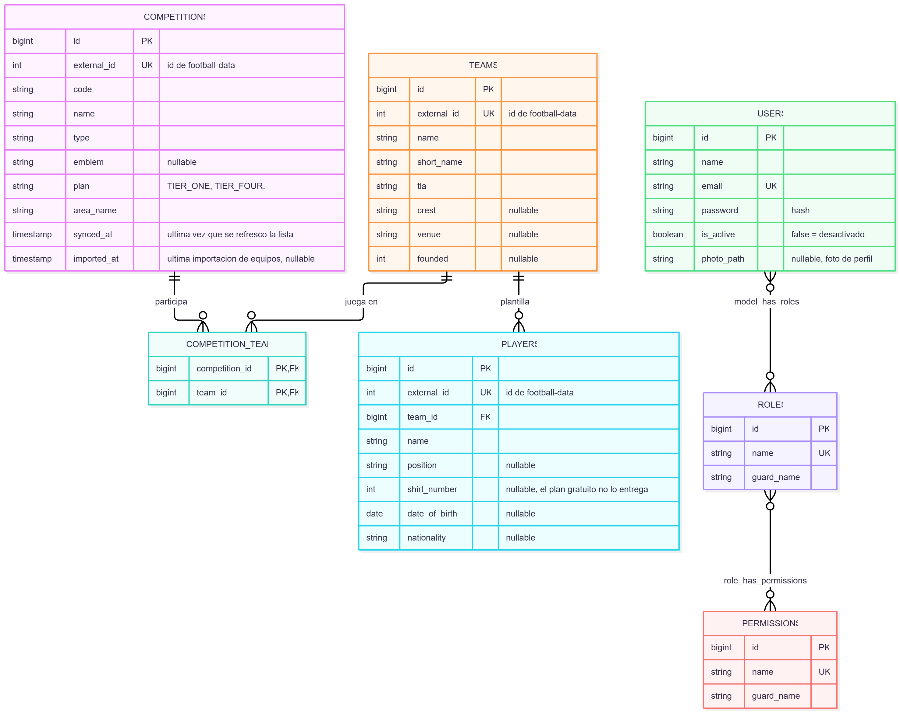

# Football Data

[](https://github.com/jsponceA/football-data/actions/workflows/ci.yml)

Plataforma interna para consultar ligas, equipos y jugadores de fútbol. Los datos vienen de
[football-data.org](https://www.football-data.org), pero la aplicación guarda su propia copia y controla qué puede
hacer cada persona según su rol. Es la solución a la prueba técnica de Senior Full Stack Developer de Inca Rail.

- **API:** Laravel 13 y PHP 8.5, autenticación con Passport, base de datos PostgreSQL.
- **SPA:** Vue 3 con TypeScript, Vuetify, Pinia y CASL. Se puede instalar como aplicación (PWA).
- **Todo junto:** un `compose.yml` levanta la base de datos, la API y la SPA con un solo comando.

## Contenido

1. [Cómo ejecutarlo](#1-cómo-ejecutarlo)
2. [Usuarios de prueba](#2-usuarios-de-prueba)
3. [Variables de entorno](#3-variables-de-entorno)
4. [Pruebas](#4-pruebas)
5. [La API](#5-la-api)
6. [Cómo resolví el problema](#6-cómo-resolví-el-problema)
7. [Decisiones de arquitectura](#7-decisiones-de-arquitectura)
8. [Frontend](#8-frontend)
9. [Despliegue en un servidor](#9-despliegue-en-un-servidor)
10. [Supuestos](#10-supuestos)
11. [Lo que quedó pendiente](#11-lo-que-quedó-pendiente)

## Estructura del repositorio

```
backend/      API Laravel
frontend/     SPA Vue
docs/         Diagramas (imagen y archivo editable de Mermaid)
docker/       Configuración de Nginx para los contenedores
compose.yml   Levanta PostgreSQL, la API y la SPA
.env.example  Variables para Docker Compose
```

## 1. Cómo ejecutarlo

Hace falta un token de football-data.org. Se pide gratis en
<https://www.football-data.org/client/register> y llega por correo.

### Opción A: con Docker (la más corta)

Requisitos: Docker con Compose.

```bash
cp .env.example .env
```

Abre `.env` y pega el token en `FOOTBALL_DATA_TOKEN`. Lo demás ya viene listo para usar en local. Después:

```bash
docker compose up --build
```

La primera vez tarda unos minutos porque construye las imágenes. Al arrancar, el contenedor de la API crea las llaves
de Passport, ejecuta las migraciones y carga los seeders sin que tengas que hacer nada más.

| Qué | Dirección |
| --- | --- |
| Aplicación (SPA) | <http://localhost:8080> |
| API | <http://localhost:8000/api> |
| Documentación de la API | <http://localhost:8000/docs/api> |

Para apagarlo: `docker compose down`. Para borrar también la base de datos y las fotos: `docker compose down -v`.

### Opción B: sin Docker

Requisitos: PHP 8.5 (con las extensiones `pdo_pgsql`, `mbstring`, `intl`, `gd`, `bcmath` y `zip`), Composer 2,
Node 22 y PostgreSQL.

**API**

```bash
cd backend
composer install
cp .env.example .env
php artisan key:generate
```

Crea la base de datos y ajusta en `backend/.env` los valores `DB_USERNAME`, `DB_PASSWORD` y `FOOTBALL_DATA_TOKEN`:

```bash
psql -U postgres -c "CREATE DATABASE db_football ENCODING 'UTF8'"
```

Después:

```bash
php artisan migrate --seed
php artisan passport:keys
php artisan storage:link
php artisan serve
```

La API queda en <http://localhost:8000>. `storage:link` hace falta para que se vean las fotos de perfil.

**SPA**, en otra terminal:

```bash
cd frontend
npm install
cp .env.example .env
npm run dev
```

Abre <http://localhost:5173>. El archivo `frontend/.env` ya apunta a la API en `http://localhost:8000/api`.

## 2. Usuarios de prueba

Los crean los seeders al preparar la base de datos.

| Correo | Contraseña | Rol | Qué puede hacer |
| --- | --- | --- | --- |
| `admin@example.com` | `password` | admin | Todo: ver y importar ligas, equipos y jugadores, y administrar usuarios y roles |
| `consulta@example.com` | `password` | solo-consulta | Solo ver ligas, equipos y jugadores |

Esa contraseña es la que se usa si no cambias nada. Se puede cambiar con `SEED_USER_PASSWORD` antes de crear la base
de datos; en un servidor real conviene hacerlo.

Cualquier persona también puede crear su cuenta desde la pantalla de registro. Entra con el rol de solo consulta y un
administrador puede cambiárselo después.

Si no configuras correo, los mensajes (bienvenida y restablecer contraseña) no se envían: quedan en el registro de la
API. En Docker se leen con `docker compose logs app`; sin Docker, en `backend/storage/logs/laravel.log`.

## 3. Variables de entorno

Hay tres archivos de ejemplo y ninguno lleva secretos. Los `.env` reales no se suben al repositorio.

| Archivo | Para qué |
| --- | --- |
| `.env.example` | Docker Compose |
| `backend/.env.example` | La API, cuando se ejecuta sin Docker |
| `frontend/.env.example` | La SPA, cuando se ejecuta sin Docker |

Las que importan:

| Variable | Qué hace |
| --- | --- |
| `FOOTBALL_DATA_TOKEN` | Token de football-data.org. Es la única obligatoria |
| `FOOTBALL_DATA_RATE_LIMIT` | Peticiones por minuto que la API se permite hacer afuera. Por defecto 9 |
| `FOOTBALL_DATA_FRESH_HOURS` | Cuántas horas un dato guardado se considera reciente. Por defecto 24 |
| `APP_URL` | Dirección pública de la API. De ahí salen las URL de las fotos |
| `FRONTEND_URL` | Dirección de la SPA. Es el único origen que acepta CORS y a donde apuntan los enlaces de los correos |
| `SEED_USER_PASSWORD` | Contraseña de los usuarios de prueba |
| `MAIL_MAILER` | `log` no envía nada; `resend` envía de verdad (necesita `RESEND_API_KEY` y un remitente verificado) |
| `TURNSTILE_SECRET` y `VITE_TURNSTILE_SITE_KEY` | Captcha de Cloudflare en registro y recuperar contraseña. Vacíos, queda apagado |

## 4. Pruebas

```bash
# API: usa SQLite en memoria y simula football-data, así que no gasta peticiones reales ni necesita token
cd backend
php artisan test

# SPA
cd frontend
npm run test:unit
npm run type-check
```

La API tiene 128 pruebas y la SPA 122. Las de la API cubren el login y los permisos de cada ruta por rol, la
importación (que no duplique registros y qué responde cuando falta cupo o falla el servicio externo), el limitador, el
cliente de football-data, la paginación, el registro y el restablecimiento de contraseña. Las de la SPA cubren las
validaciones, el guardián de rutas, el cierre de sesión por token vencido y los componentes que más lógica tienen.

En cada `push` y en cada pull request, GitHub Actions ejecuta las pruebas de la API, y las de la SPA junto con la
revisión de tipos y la compilación (`.github/workflows/ci.yml`).

## 5. La API

Con `APP_ENV=local` (el valor por defecto de los ejemplos) la documentación interactiva está en `/docs/api`. Se
genera sola a partir de las rutas, las validaciones y los resources. En producción queda cerrada.

Todas las rutas van bajo `/api` y, salvo las públicas, piden el token en `Authorization: Bearer <token>`.

| Método y ruta | Permiso | Qué hace |
| --- | --- | --- |
| `POST /login` | pública | Devuelve el token y los datos de la persona |
| `POST /register`, `/forgot-password`, `/reset-password` | pública | Crear cuenta y recuperar contraseña |
| `POST /logout` | sesión | Invalida el token |
| `GET /me` | sesión | Datos de quien inició sesión y sus permisos |
| `GET /competitions` | `competitions.view` | Todas las ligas |
| `GET /competitions/{id}` | `competitions.view` | Detalle de una liga; guarda sus equipos y jugadores |
| `GET /team` y `GET /team/{id}` | `teams.view` | Equipos guardados y detalle de uno |
| `GET /players` | `players.view` | Jugadores guardados |
| `/users` (listar, crear, ver, editar, activar o desactivar, foto) | `users.manage` | Gestión de usuarios |
| `/roles` y `GET /permissions` | `roles.manage` | Gestión de roles y permisos |

Las cinco rutas de la prueba están tal como se piden, incluido `/team` en singular. En todas, `{id}` es el id que usa
football-data.org (por ejemplo `/competitions/2021` para la Premier League y `/team/57` para el Arsenal), así que el id
interno de la base de datos nunca se expone.

Los errores siempre salen en JSON con el mismo formato, `{ "message": "..." }`, y el 422 añade el detalle por campo:

| Código | Cuándo |
| --- | --- |
| 401 | Falta el token o venció |
| 403 | La persona no tiene el permiso, o la liga no está en el plan gratuito |
| 404 | La liga, el equipo o el jugador no existe |
| 422 | Datos inválidos |
| 429 | Se acabó el cupo de football-data y no hay copia local. Trae `Retry-After` con los segundos de espera |
| 502, 503 | football-data no responde o no está configurado, y no hay copia local |

## 6. Cómo resolví el problema

### Arquitectura


La SPA habla solo con la API de Laravel. La API valida el token con Passport, revisa el permiso de la ruta y deja el
trabajo en servicios. Los servicios leen y guardan en PostgreSQL con Eloquent, y solo cuando un dato no es reciente
pasan por el limitador antes de llamar a football-data. Esa llamada sale por una única clase, `FootballDataClient`.
Archivo editable: [`docs/arquitectura.mmd`](docs/arquitectura.mmd).

### El límite de 10 peticiones por minuto

El plan gratuito de football-data solo deja hacer 10 peticiones por minuto. Lo resolví con tres reglas.

**1. Primero lo que ya tengo.** Las rutas `/team`, `/team/{id}` y `/players` solo leen de la base de datos y nunca llaman
afuera. Las ligas también se responden desde la base de datos mientras el dato sea reciente (24 horas, configurable).
Así, aunque football-data esté caído o sin cupo, todo lo guardado se puede consultar.

**2. Importar una liga cuesta dos llamadas como máximo.** Comprobé con el token real que `GET /competitions/{id}/teams`
ya trae cada equipo con su plantilla. Por eso importar una liga es: la lista de ligas (solo si está vieja o la liga
no se conocía) y los equipos. Eso permite hacerlo en la misma petición, sin colas.

**3. Un limitador propio, antes de llamar.** La API cuenta sus llamadas salientes y se permite 9 por minuto, una menos
que el tope, para tener margen. El contador vive en la caché, así que lo comparten todos los procesos. El cliente se
niega a llamar si no queda cupo y cuenta cada llamada antes de hacerla, porque aunque falle igual gasta una del
plan. Además, antes de importar una liga el servicio pregunta si alcanza para las dos llamadas, para no dejar una
importación a medias. Si no hay cupo, no intenta nada y responde así.

| Situación | Con copia local | Sin copia local |
| --- | --- | --- |
| Sin cupo | 200 con los datos guardados y `meta.stale: true` | 429 con `Retry-After` |
| football-data caído o con error | 200 con los datos guardados y `meta.stale: true` | 502 o 503 |
| Liga de pago (plan distinto a `TIER_ONE`) | 403, sin gastar ninguna llamada | 403 |
| Liga inexistente | 404 | 404 |

La SPA usa `meta.stale` para mostrar un aviso de que los datos pueden estar desactualizados, y el `Retry-After` para
decirle a la persona cuántos segundos esperar.

Elegí no usar una cola para la importación. Son dos llamadas, la persona está esperando el resultado y una cola
agregaría un servicio más que operar y una pantalla de "importando...". Lo dejo como mejora en
[lo pendiente](#11-lo-que-quedó-pendiente).

### Flujo de importación


Es la secuencia completa de `GET /competitions/{id}`: qué se revisa primero, cuándo se pide cupo, qué se responde en
cada fallo y cómo se guardan los datos. La escritura va en una transacción y con `upsert`, por eso consultar la misma
liga dos veces no duplica nada, y los jugadores que ya no están en una plantilla se retiran de ese equipo.
Archivo editable: [`docs/flujo-importacion.mmd`](docs/flujo-importacion.mmd).

### Autenticación y permisos

Passport entrega un token con `POST /login` (dura 8 horas) y `POST /logout` lo revoca. Las contraseñas se guardan con
hash. Una persona desactivada no puede usar la API, y al desactivarla se cierran todas sus sesiones.

Los permisos se manejan con `spatie/laravel-permission`, con el formato `recurso.acción`: `competitions.view`,
`teams.view`, `players.view`, `users.manage` y `roles.manage`. Cada ruta de la API exige su permiso, así que la
seguridad no depende de lo que muestre la interfaz. Un administrador puede crear roles nuevos y elegir sus permisos
desde la SPA.

`GET /me` devuelve los permisos de la persona ya en el formato de CASL, por ejemplo
`{ "action": "view", "subject": "teams" }`, y con eso la SPA decide qué rutas y botones mostrar.

### Modelo de datos



Ligas, equipos y jugadores guardan el `external_id` de football-data, con índice único, que es lo que permite hacer
`upsert` sin duplicar. Una liga y un equipo se relacionan en una tabla intermedia, porque un equipo puede jugar varias
competiciones. Los usuarios, roles y permisos son las tablas de `spatie/laravel-permission`.
Archivo editable: [`docs/modelo-datos.mmd`](docs/modelo-datos.mmd).

## 7. Decisiones de arquitectura

Usé las capas simples de Laravel y no apliqué DDD, arquitectura hexagonal, Clean Architecture ni CQRS.

```
Ruta -> Middleware (token y permiso) -> Controlador -> Servicio -> Modelo (Eloquent)
                                          |    |
                           FormRequest <--+    +--> Resource            Servicio -> FootballDataClient -> football-data.org
                         (valida entrada)        (da forma a la salida)
```

- Los controladores solo reciben la petición y devuelven un resource. La lógica está en los servicios
  (`CompetitionService`, `UserService`, `RoleService`...).
- La validación está en FormRequests y la salida en Resources.
- Todo lo que habla con football-data está en `FootballDataClient`, y el limitador en `ApiRateLimiter`.

Comparé estas opciones:

| Opción | Lo bueno | Por qué no |
| --- | --- | --- |
| Hexagonal o Clean Architecture | El dominio queda aislado de Laravel y de la fuente de datos | El dominio es casi solo "guardar lo que llega y servirlo". Habría muchas interfaces y clases que solo reenvían la llamada |
| DDD | Útil cuando hay reglas de negocio ricas | Aquí no las hay: las reglas importantes son de acceso y de límite de peticiones |
| CQRS y eventos | Separa lecturas y escrituras | Las lecturas salen de las mismas tablas que escriben y no hay nadie más que reaccione a un evento |
| Capas simples de Laravel | Se entiende a la primera, es lo que espera quien conoce Laravel | Si el dominio crece, habrá que separarlo |

Lo que sí hice para dejar abierta la puerta: la dependencia externa está detrás de una sola clase, así que cambiar de
proveedor o pasarlo a un puerto es tocar un archivo. Si apareciera una segunda fuente de datos o reglas de negocio más
complejas, ese sería el momento de pasar a hexagonal.

## 8. Frontend

SPA con Vue 3, Vue Router, TypeScript y Composition API. Usa Vuetify para el diseño, Pinia (con persistencia) para la
sesión y CASL para los permisos.

- Pantallas: inicio, ligas con el detalle de cada una, equipos, jugadores, usuarios, roles y permisos, perfil, y el
  flujo de entrada (login, registro, olvidé mi contraseña).
- Se ve bien en celular y en escritorio, con modo claro y oscuro.
- Cada ruta declara el permiso que necesita. Si falta, la persona ve una pantalla de "sin acceso" y no una página rota.
  Si la sesión vence, vuelve al login con un aviso y regresa a donde estaba al volver a entrar.
- Cargas con esqueletos, listas vacías, errores con mensaje claro y avisos cuando falla football-data o se alcanza el
  límite. Listados con búsqueda, filtros y paginación.
- Componentes reutilizables: tablas, formularios, diálogos de confirmación, estados de carga, etc.
- Es una PWA: se puede instalar en el celular o en el escritorio. Guarda la aplicación para abrirla rápido y avisa
  cuando hay una versión nueva, pero nunca guarda en caché las respuestas de la API, para no dejar datos de personas
  en el dispositivo.

## 9. Despliegue en un servidor

El mismo `compose.yml` sirve para un servidor. La SPA y la API van en dominios distintos (por ejemplo
`app.midominio.com` y `api.midominio.com`) y el HTTPS lo pone el Nginx del propio servidor, con certbot.

1. En el `.env`: pon las dos URLs reales en `APP_URL` y `FRONTEND_URL`, `APP_ENV=production`, contraseñas propias
   en `POSTGRES_PASSWORD` y `SEED_USER_PASSWORD`, y descomenta `BIND_ADDRESS=127.0.0.1` y `RESTART_POLICY`.
   Con `BIND_ADDRESS` los contenedores solo escuchan en el propio servidor. Si el servidor ya usa los puertos 8080 u
   8000, cámbialos con `FRONT_PORT` y `API_PORT`.
2. `docker compose up -d --build`.
3. En el Nginx del servidor, un sitio por dominio que reenvíe al puerto que corresponda:

```nginx
server {
    server_name app.midominio.com;
    location / {
        proxy_pass http://127.0.0.1:8080;
        proxy_set_header Host $host;
        proxy_set_header X-Forwarded-For $proxy_add_x_forwarded_for;
        proxy_set_header X-Forwarded-Proto $scheme;
    }
}
# igual para api.midominio.com hacia el puerto 8000; después: certbot --nginx
```

Si pones Cloudflare delante, usa el modo SSL "Full (strict)", y en el Nginx del servidor restaura la IP real de quien
visita (`real_ip_header CF-Connecting-IP`). Si no, el limitador de intentos de login vería siempre la IP de Cloudflare.

Para actualizar: `git pull && docker compose up -d --build`. Las variables `VITE_` se escriben al compilar la SPA, por
eso hay que reconstruir si cambian.

## 10. Supuestos

- **Rutas públicas.** La prueba dice que todas las rutas salvo el login van protegidas. Añadí registro y recuperar
  contraseña, que por naturaleza son públicas, con límite de intentos por minuto y captcha opcional. Todo lo demás exige
  token.
- **Número de camiseta.** El plan gratuito de football-data no entrega `shirtNumber` en ninguna plantilla. La columna
  existe y se llena si algún plan lo trae, pero con el plan gratuito queda vacía.
- **Solo las ligas del plan gratuito.** Las ligas de pago aparecen en el listado, atenuadas y con la etiqueta "Plan de
  pago", y no se pueden abrir. Si alguien llama a la API directamente, recibe un 403 con el mensaje "Esa liga no está
  disponible con el plan gratuito".
- **Una liga importada es reciente durante 24 horas.** Dentro de ese plazo no se vuelve a pedir nada afuera.
- **Quien se registra entra como solo consulta.** Un administrador puede darle más permisos.
- **Un administrador no puede quedarse fuera.** No puede desactivarse ni cambiarse sus propios roles.
- **La nacionalidad de los jugadores se guarda como texto**, tal como la entrega football-data (que a veces usa dos
  nombres para el mismo país).
- **Hay un solo contador de cupo para toda la API,** no uno por persona: el límite es de la cuenta de football-data.

## 11. Lo que quedó pendiente

- **Colas y tareas programadas.** No hay Jobs ni cron. Con más tiempo, la importación iría en un Job que lance el
  evento `CompetitionImported`, y un cron refrescaría las ligas más consultadas de madrugada, que es cuando sobra cupo.
- **Importar todas las ligas gratuitas de una vez.** Son 12 ligas y 24 llamadas como mínimo, así que habría que
  repartirlas en el tiempo respetando el cupo; es el caso natural para la cola.
- **Pruebas de aceptación de punta a punta.** Hay pruebas de la API con base de datos y de la SPA, pero no un navegador
  automatizado que recorra el flujo completo.
- **Pruebas contra PostgreSQL.** Las pruebas de la API usan SQLite en memoria. La base real es PostgreSQL, y ahí podrían
  aparecer diferencias (por ejemplo, en las búsquedas sin distinguir mayúsculas).
- **Análisis de estilo en el CI.** Laravel Pint está instalado, pero el código aún no sigue sus reglas, así que no lo
  puse en el pipeline.
- **Despliegue automático.** Hoy se hace a mano con `git pull`. Automatizarlo exigiría guardar una llave SSH como secreto
  del repositorio.
